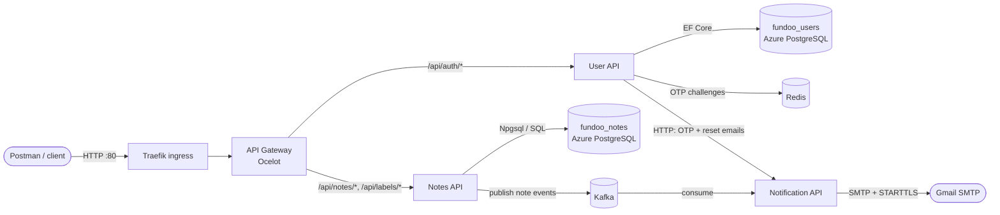
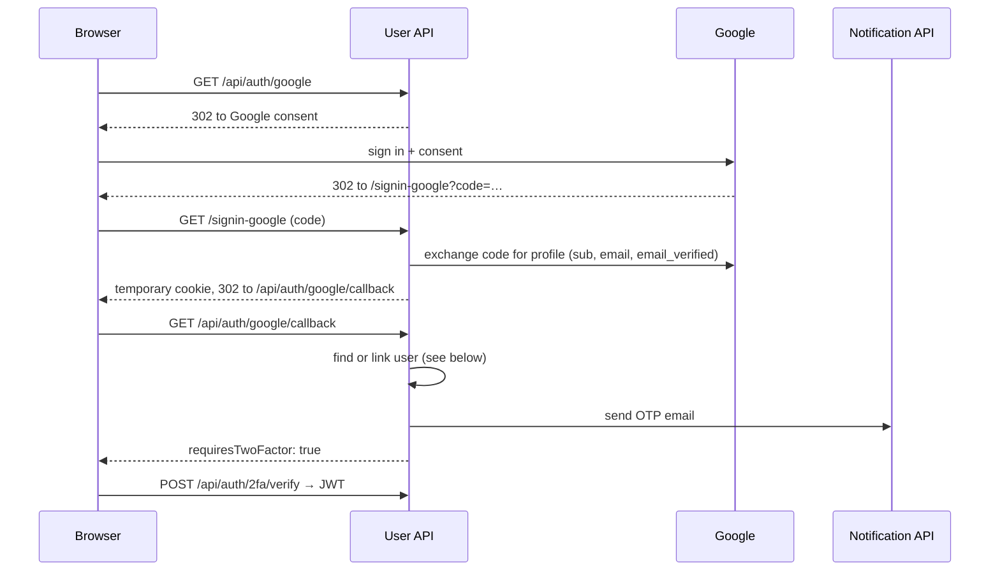

# Fundoo Microservices — Project Overview

Fundoo is a Google-Keep-style notes backend built as **.NET 8 microservices**. Users sign up, log in with an
emailed one-time code (2FA) or Google, and manage notes and labels. It runs on a single Azure VM with
**k3s** (lightweight Kubernetes), uses **Azure Database for PostgreSQL**, and is built and deployed by
**Jenkins** on every push to `main`.

**Live:** `http://20.6.128.31` · Swagger: `/docs/user/` and `/docs/notes/` · Jenkins: `http://20.6.128.31:8080`

---

## 1. Architecture



Everything except PostgreSQL runs inside k3s in the `fundoo` namespace. Only the gateway is public; the
services talk to each other by Kubernetes service name (`user-api`, `notes-api`, `notification-api`, `kafka`,
`redis`).

## 2. What each service does

| Service | Project | Responsibility | Talks to |
|---|---|---|---|
| **API Gateway** | `src/ApiGateway/Fundoo.ApiGateway` | Single public entry point (Ocelot). Routes `/api/auth/*` → User API, `/api/notes*` and `/api/labels*` → Notes API, `/docs/user/` and `/docs/notes/` → each API's Swagger UI. (The local `ocelot.json` also has a retry/rate-limit policy on note reads; the cluster routes in `deploy/k8s/00-namespace-config.yaml` don't.) | User API, Notes API |
| **User API** | `src/Services/User/*` | Registration, login, **2FA by email OTP**, forgot/reset password, **Google OAuth** sign-in. Issues the **JWT** that the other services trust. | PostgreSQL `fundoo_users` (EF Core), Redis, Notification API (HTTP) |
| **Notes API** | `src/Services/Notes/*` | Notes CRUD, pin/colour, archive/unarchive, trash/restore, permanent delete (only from trash); labels CRUD and attach/detach to notes. Every endpoint requires the JWT; data is scoped to the token's user. Publishes note events to Kafka. | PostgreSQL `fundoo_notes` (raw SQL via Npgsql), Kafka |
| **Notification API** | `src/Services/Notification/*` | Sends all emails (OTP, password reset, note activity, welcome template) over SMTP. Has an HTTP API used by the User service, and a background **Kafka consumer** for note events. A bulkhead limits it to 5 concurrent SMTP sends. Internal only (not routed by the gateway). | SMTP, Kafka |
| `Fundoo.EventContracts` | `src/BuildingBlocks` | Shared `NoteEvent` message contract used by the Notes producer and Notification consumer. | — |

Backing stores:

| Store | Where | Holds |
|---|---|---|
| **PostgreSQL** `fundoo_users` | Azure Database for PostgreSQL (`fundoo-db-server`) | `Users`, `PasswordResetTokens`, `ExternalLogins`, EF migrations history |
| **PostgreSQL** `fundoo_notes` | same server | `notes`, `labels`, `note_labels` |
| **Redis** | k3s pod | Short-lived 2FA OTP challenges (hashed code, attempt counter, TTL) |
| **Kafka** | k3s StatefulSet (KRaft, 5 GiB volume) | Note events (see §4) |

## 3. Main request flows

### Register → Login → 2FA → token

1. `POST /api/auth/register` — validates input (FluentValidation), stores the user with a **BCrypt** password
   hash. No email is sent at registration.
2. `POST /api/auth/login` — checks the password, then **always** starts a 2FA challenge:
   - generates a 6-digit code, stores an **HMAC-SHA256 hash** of it in Redis under
     `fundoo:2fa:otp:<userId>` with a **10-minute TTL** and an attempt counter;
   - calls Notification API `POST /api/notifications/2fa-otp`, which emails the code.
   - Response: `requiresTwoFactor: true`, no token yet. If the email can't be sent, the challenge is
     cancelled and login fails.
3. `POST /api/auth/2fa/verify` with `{email, code}` — a Redis Lua script checks the hash atomically; **3 wrong
   attempts** burn the challenge. On success the key is deleted and a **JWT** is returned (issuer
   `fundoo-user-api`, audience `fundoo-clients`, 30 min).
4. Every Notes/Labels call sends `Authorization: Bearer <jwt>`. The Notes API validates it with the same
   signing key and reads the user id from the `sub` claim.

### Forgot / reset password

`POST /api/auth/forgot-password` always returns 200 (no account enumeration). If the user exists, a random
token is created (stored **hashed**, valid **15 minutes**, older tokens invalidated) and emailed through
`POST /api/notifications/password-reset`. `POST /api/auth/reset-password` with `{email, token, newPassword}`
sets the new BCrypt hash.

## 4. Kafka — what goes in which topic

| Topic | Producer | Published when | Consumer | Result |
|---|---|---|---|---|
| `notes.created.v1` | Notes API | `POST /api/notes` succeeds | Notification API (`NoteEventsConsumer`) | "Note activity" email to the note owner |
| `notes.updated.v1` | Notes API | `PUT /api/notes/{id}` succeeds | Notification API | "Note activity" email to the note owner |
| `notes.events.dead-letter.v1` | Notification API | an event can't be parsed (bad JSON / invalid data) | nobody (for inspection) | original record copied here with headers describing the failure |

**Message** (`NoteEvent`, JSON value, key = `NoteId` so all events of one note stay ordered in one partition):

```json
{
  "eventId": "8f0c…", "eventType": "notes.created.v1", "version": 1,
  "occurredAtUtc": "2026-11-23T07:43:33Z",
  "noteId": "b7a5…", "userId": "1c30…",
  "recipientEmail": "owner@example.com", "title": "My first note"
}
```

**Delivery guarantees**
- Producer: `Acks = All` + idempotence, so a sent event is stored once.
- Consumer group `fundoo-notifications-v1`, auto-commit **off**: the offset is committed only after the email
  was sent, so a crash means the event is retried (at-least-once). Starts from the earliest offset, so events
  published while the consumer is down are not lost.
- Malformed events go to the dead-letter topic instead of blocking the partition; other failures (e.g. SMTP
  down) are retried.
- Topics are created by the `kafka-topics` Job (auto-create is disabled). Jenkins waits for that Job and
  then restarts the Notification API, because the consumer doesn't pick up topics that were missing when it
  started.

## 5. Google OAuth (SSO)



How the callback decides who you are:
1. Google must return a **verified** email, otherwise sign-in is refused.
2. If an `ExternalLogins` row exists for (`Google`, Google `sub`), that user is used.
3. Otherwise the user with the same email is used, or a new user is created (with a random, unusable
   password), and an `ExternalLogins` row links the Google account to it.
4. Google sign-in **does not skip 2FA**: an OTP is emailed and the JWT is only issued after
   `POST /api/auth/2fa/verify`.

Implementation: the Google handler signs into a short-lived cookie scheme `GoogleExternal` (5 min, HttpOnly,
`Secure`), which the callback reads and then clears. Config: `Authentication:Google:ClientId` /
`ClientSecret`; if they're empty the Google handler isn't registered and `/api/auth/google` returns 503.

**Status on Azure:** disabled. It needs a Google Cloud OAuth client with redirect URI
`https://<your-domain>/signin-google`, and HTTPS (the cookie is `Secure` and Google requires HTTPS redirect
URIs for non-localhost hosts). The deployment currently serves plain HTTP on an IP address, and the cluster gateway would also need a route for
`/signin-google` → User API.

## 6. What Jenkins automates

Jenkins runs on the same VM as k3s. The `fundoo` pipeline job (created automatically by
`deploy/azure/setup-vm.sh` using Jenkins Configuration-as-Code) **polls GitHub every 5 minutes** and runs the
[`Jenkinsfile`](Jenkinsfile) on every new commit to `main`:

| # | Stage | What it does |
|---|---|---|
| 1 | Checkout | Pulls `main` from `github.com/18-dhruv/Fundoo2` |
| 2 | **Unit tests** | `dotnet test` (11 NUnit tests) inside the .NET 8 SDK container; results archived. A failure stops the pipeline. |
| 3 | **Build images** | One Docker image per service from the shared `Dockerfile`, tagged `<build>-<commit>` |
| 4 | Push to ACR | Skipped (no registry). Used only if `ACR_NAME` is set. |
| 5 | **Load images into k3s** | `docker save … \| k3s ctr images import -` — images go straight into the cluster's container runtime, no registry needed |
| 6 | **DB migrations** | `deploy/db/migrate.sh`: `dotnet ef database update` for `fundoo_users`, `deploy/db/notes-db.sql` for `fundoo_notes`, against Azure PostgreSQL. Runs *before* the deploy so new code never meets an old schema. |
| 7 | **Deploy to k3s** | `kubectl apply -k deploy/` with this build's image tags, waits for the Kafka topics, restarts the Notification API, waits for every rollout, prunes old images |
| — | On failure | Prints pod status and recent cluster events to the build log |

Jenkins credentials (all created by the setup scripts, never in Git):

| ID | Used for |
|---|---|
| `k3s-kubeconfig` | `kubectl` access to the cluster |
| `azure-pg` | Postgres admin login for migrations |
| `acr-credentials` | only when pushing to Azure Container Registry |

App secrets (connection strings, JWT signing key, SMTP) live in the Kubernetes secret `fundoo/fundoo-secrets`,
written by `deploy/azure/set-secrets.sh`, which prompts for the passwords on the VM.

## 7. Deployment layout

| Path | Purpose |
|---|---|
| `Dockerfile` | One multi-stage build for all services (`--build-arg PROJECT=… DLL=…`) |
| `deploy/k8s/00-namespace-config.yaml` | Namespace, shared settings (ConfigMap), gateway routes for the cluster |
| `deploy/k8s/10-infra.yaml` | Redis, Kafka StatefulSet, `kafka-topics` Job |
| `deploy/k8s/20-apps.yaml` | The 4 service Deployments + Services, health probes, Traefik Ingress |
| `deploy/kustomization.yaml` | Ties the manifests together; Jenkins sets image names/tags here |
| `deploy/db/` | `migrate.sh`, Notes schema SQL |
| `deploy/azure/setup-vm.sh` | Installs k3s, Docker, Java 21, Jenkins and configures Jenkins as code |
| `deploy/azure/set-secrets.sh` | Interactive: Postgres + SMTP passwords → k8s secret and Jenkins credential |
| `deploy/AZURE_DEPLOY.md` | Step-by-step Azure guide |
| `postman/` | Postman collection (all endpoints, auto-saves token/ids) + environments |
| `deploy/k8s/30-observability.yaml` | OpenTelemetry Collector in k3s (services → collector → SigNoz) |
| `deploy/observability/` | SigNoz docker compose (local + separate SigNoz VM), dashboard and alert JSON |

## 8. Using it

1. Import `postman/FundooMicroservices.postman_collection.json` (works without an environment;
   `baseUrl` = `http://20.6.128.31`).
2. Set the collection variable `email` to an inbox you can read.
3. Register → Login → copy the emailed code into `otpCode` → Verify 2FA → Notes / Labels.

Or open Swagger at `http://20.6.128.31/docs/user/` (auth) and `http://20.6.128.31/docs/notes/`
(click **Authorize** and paste the JWT).

## 9. Observability (OpenTelemetry + SigNoz)

Every service calls `builder.AddFundooObservability("<service-name>")` (shared project
`src/BuildingBlocks/Fundoo.Observability`) and exports **traces, metrics and logs over OTLP**:

- One trace per user operation across gateway → User/Notes API → Notification API, including the Kafka hop
  (W3C `traceparent` in the record headers) and spans for Postgres, Redis, HttpClient, Kafka and SMTP.
- RED metrics per service, .NET runtime and Npgsql metrics, plus `fundoo.messaging.consumed` and `fundoo.email.*`.
- Logs carry `trace_id`/`span_id`. Sensitive data (bodies, auth headers, tokens, OTPs, e-mails, query strings,
  connection strings, note content) is redacted in process and again in the collector.
- Locally: `docker compose -f deploy/observability/signoz/docker-compose.signoz.yml up -d` → http://localhost:8080.
  In k3s: services → `otel-collector` → SigNoz on a separate VM (address in the `signoz-backend` secret, written by
  `set-secrets.sh`).

Full details (what changed, the spec behind each expectation, what is redacted, how to answer questions in SigNoz):
[`docs/OBSERVABILITY.md`](docs/OBSERVABILITY.md). Running SigNoz: [`deploy/observability/README.md`](deploy/observability/README.md).

## 10. Known limitations

- Plain HTTP on an IP address: tokens travel unencrypted, and Google SSO can't be enabled until there's a
  domain with HTTPS.
- Single VM: k3s, Kafka, Jenkins and the services share one machine; no high availability.
- Swagger is public on the deployed environment (set `Swagger__Enabled` to `"false"` in
  `deploy/k8s/00-namespace-config.yaml` to turn it off).
- `Microsoft.AspNetCore.WebUtilities` 8.0.23 has a known high-severity advisory; update the package.
- The original `appsettings.json` contains a sample `InternalService:SharedSecret` committed to Git; the cluster
  overrides it with a random value.
