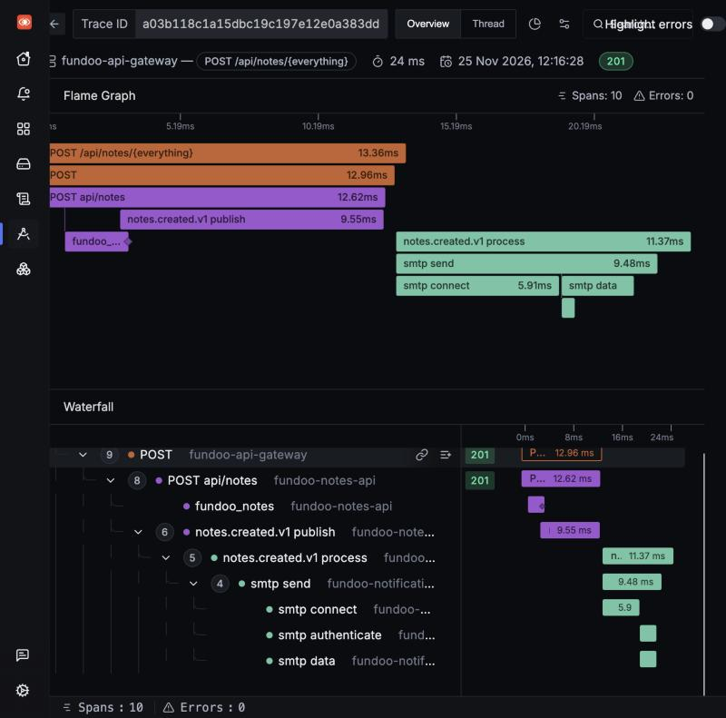
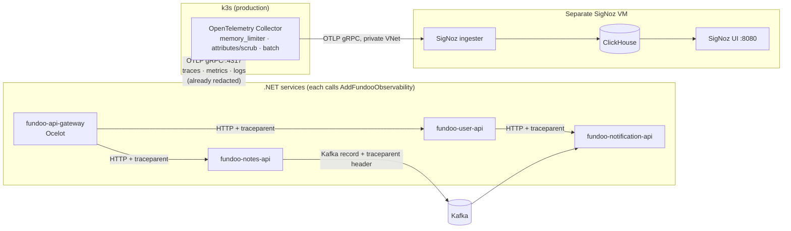
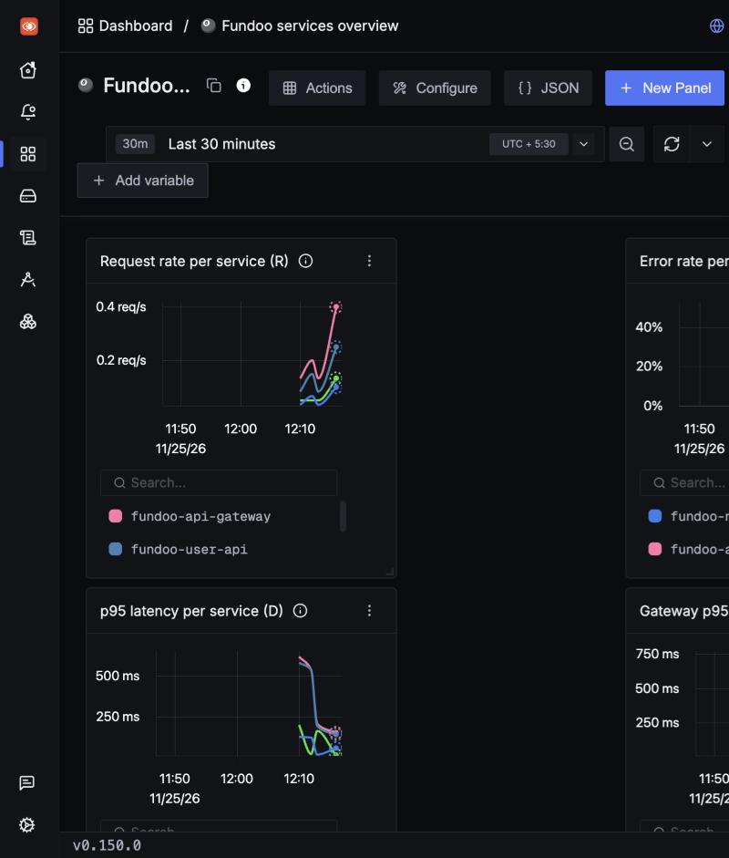

# Observability: OpenTelemetry + SigNoz

This document covers what was changed to add distributed tracing, metrics and logs to the Fundoo
services, which standards were used for each of the team's eight expectations, and which part of the
implementation handles which part. Running SigNoz locally and on the separate production VM is covered in
[`deploy/observability/README.md`](../deploy/observability/README.md).

---

## 1. Architecture

- **In process:** the OpenTelemetry .NET SDK creates spans, metrics and log records. A redaction processor
  scrubs them, and the OTLP exporter sends them out.
- **Locally:** the services send straight to the SigNoz ingester on `localhost:4317` (no configuration needed).
- **In k3s:** the services send to the `otel-collector` Service. The collector forwards to SigNoz on the separate VM.
  The SigNoz address is stored in a k8s secret, so moving to another backend (for example SigNoz Cloud) is a
  secret change, with no code or image change.

## 2. What was changed

### New code

| File | Purpose |
|---|---|
| `src/BuildingBlocks/Fundoo.Observability/Fundoo.Observability.csproj` | New shared project with the pinned OpenTelemetry packages (§3). |
| `.../ObservabilityExtensions.cs` | `builder.AddFundooObservability(serviceName, configureTracing?, enrichServerSpan?)`: resource attributes, tracing, metrics and logging with OTLP exporters, the redaction processors, and filters for health and Swagger requests. This is the one place where telemetry is configured. |
| `.../FundooTelemetry.cs` | The `Fundoo.Messaging` and `Fundoo.Email` ActivitySources, the `Fundoo` Meter (counters and a histogram), W3C context inject/extract helpers for Kafka headers, and `RecordError()`, which records exceptions with masked messages. |
| `.../SensitiveDataRedactor.cs` | The redaction rules: which keys are dropped, URL/query/SQL sanitising, and masking of e-mails, JWTs and Bearer tokens. |
| `.../RedactionProcessors.cs` | `RedactingActivityProcessor` (spans) and `RedactingLogProcessor` (logs). Both run before the exporter. |
| `tests/Fundoo.UnitTests/ObservabilityTests.cs` | 21 tests: redaction rules, the span processor, and that a Kafka consumer span continues the producer's trace. |

### Changed code

| File | Change |
|---|---|
| `src/ApiGateway/.../Program.cs` | Calls `AddFundooObservability("fundoo-api-gateway", ...)` and names server spans after the matched Ocelot upstream template (`POST /api/notes/{everything}`), because Ocelot has no ASP.NET route. |
| `src/Services/User/.../Program.cs` | `AddFundooObservability("fundoo-user-api", t => t.AddRedisInstrumentation())`. |
| `src/Services/Notes/.../Program.cs`, `src/Services/Notification/.../Program.cs` | `AddFundooObservability("fundoo-notes-api" / "fundoo-notification-api")`. |
| `Notes.Infrastructure/Messaging/KafkaNoteEventPublisher.cs` | A PRODUCER span `"<topic> publish"` around `ProduceAsync`. Injects `traceparent`/`tracestate`/`baggage` into the Kafka record headers and records the partition and offset. |
| `Notification.Api/Services/Messaging/NoteEventsConsumer.cs` | Extracts the context from the headers and starts a CONSUMER span `"<topic> process"` as a child of the producer span. Records errors, and counts records by outcome (`processed` / `dead_lettered` / `retried`). The span ends before the 2 s retry back-off. |
| `Notification.Api/Services/Messaging/KafkaDeadLetterPublisher.cs` | A PRODUCER span for the dead-letter publish, inside the consumer's span. The DLQ record carries the trace context. |
| `Notification.Api/Services/SmtpEmailService.cs` | A CLIENT span `smtp send` with child spans `smtp connect` / `smtp authenticate` / `smtp data`. Records `fundoo.email.sent` and `fundoo.email.duration` by template and outcome. New optional setting `EmailSettings:SecureSocketOptions` (default `StartTls`; `None` for local Mailpit only). |
| `*.csproj`, `FundooMicroservice.slnx` | References to the new project. The User API also references `OpenTelemetry.Instrumentation.StackExchangeRedis`. |
| `Dockerfile` | `ARG VERSION`, exported as `SERVICE_VERSION` and used as `service.version`. |
| `Jenkinsfile` | Passes `--build-arg VERSION=<build>-<commit>` (the image tag). |

### Deployment and tooling

| File | Change |
|---|---|
| `deploy/k8s/30-observability.yaml` | **New.** OpenTelemetry Collector (`otel/opentelemetry-collector-contrib:0.164.0`): ConfigMap, Deployment (64–224 Mi) and Service on ports 4317/4318. |
| `deploy/kustomization.yaml` | Adds `k8s/30-observability.yaml`. |
| `deploy/k8s/00-namespace-config.yaml` | `fundoo-config` gains `OTEL_EXPORTER_OTLP_ENDPOINT=http://otel-collector:4317`, `OTEL_EXPORTER_OTLP_PROTOCOL=grpc`, `OTEL_METRIC_EXPORT_INTERVAL=30000` and `DEPLOYMENT_ENVIRONMENT=production`. |
| `deploy/k8s/20-apps.yaml` | Each Deployment sets `OTEL_RESOURCE_ATTRIBUTES=k8s.pod.name=<pod>,k8s.namespace.name=fundoo` (pod name from the downward API). |
| `deploy/azure/set-secrets.sh` | Asks for the SigNoz endpoint, TLS mode and optional ingestion key, and writes them to the `fundoo/signoz-backend` secret (never stored in Git). `SIGNOZ_ONLY=1` updates just that secret. |
| `deploy/observability/signoz/*` | **New.** SigNoz docker compose (Foundry v0.5.0 output with pinned images), used locally and on the SigNoz VM. |
| `deploy/observability/dashboards/fundoo-services.json` | **New.** SigNoz dashboard (schema v6, 10 panels). |
| `deploy/observability/alerts/fundoo-high-error-rate.json` | **New.** Example alert rule (schema v2alpha1). |
| `docker-compose.yml` | Optional `mailpit` service (`--profile mail`), a local SMTP inbox so SMTP spans can be tested without Gmail. |

## 3. Specifications and libraries used

| Spec / library | Version | Used for |
|---|---|---|
| [OpenTelemetry .NET SDK](https://github.com/open-telemetry/opentelemetry-dotnet): `OpenTelemetry`, `.Extensions.Hosting`, `.Exporter.OpenTelemetryProtocol` | **1.20.1** (pinned) | Tracer, meter and logger providers, OTLP export. 1.20.x is the newest line that still ships a `net8.0` build (1.21 dropped it). |
| `OpenTelemetry.Instrumentation.AspNetCore` / `.Http` | **1.20.2** | Incoming and outgoing HTTP spans and metrics. |
| `OpenTelemetry.Instrumentation.Runtime` | **1.20.1** | GC, thread pool, JIT and exception metrics. |
| `OpenTelemetry.Instrumentation.StackExchangeRedis` | **1.20.1-beta.1** | Redis spans. No stable release exists; this is the only beta package used. |
| Npgsql built-in `ActivitySource "Npgsql"` / `Meter "Npgsql"` | Npgsql 8.0.x (already referenced) | PostgreSQL spans for both raw Npgsql (Notes) and EF Core (User; EF runs through Npgsql), plus pool metrics. No extra package needed. |
| [W3C Trace Context](https://www.w3.org/TR/trace-context/) (`traceparent`, `tracestate`) and [W3C Baggage](https://www.w3.org/TR/baggage/) | REC | Context propagation over HTTP (automatic) and in Kafka headers (manual, `CompositeTextMapPropagator`). |
| [OTLP](https://opentelemetry.io/docs/specs/otlp/) gRPC (4317) / HTTP (4318) | 1.x | Transport from services to collector to SigNoz. |
| [OTel environment variable spec](https://opentelemetry.io/docs/specs/otel/configuration/sdk-environment-variables/) | — | `OTEL_EXPORTER_OTLP_ENDPOINT/PROTOCOL/HEADERS`, `OTEL_SERVICE_NAME`, `OTEL_RESOURCE_ATTRIBUTES`, `OTEL_METRIC_EXPORT_INTERVAL`, `OTEL_SDK_DISABLED`. |
| [Semantic conventions](https://opentelemetry.io/docs/specs/semconv/): HTTP (stable), database, messaging (Kafka), exceptions, resource (`service.*`, `deployment.environment[.name]`, `k8s.*`) | v1.2x | Attribute names on every span and metric, so SigNoz's built-in APM views (services, external calls, DB calls, messaging) work without custom mapping. |
| OpenTelemetry Collector contrib | **0.164.0** | In-cluster buffer, scrubbing and routing. |
| SigNoz | **v0.150.0** (otel-collector v0.144.15, ClickHouse 25.12.5) | Backend and UI. Dashboard schema v6, alert rule schema v2alpha1. |

## 4. The eight expectations: which spec, which code, how it works, how to use it

### 1 · Follow a request across services

| | |
|---|---|
| **Spec** | W3C Trace Context; messaging semantic conventions (producer/consumer span kinds, parent-child for a single message). |
| **Code** | HTTP: `AddAspNetCoreInstrumentation` + `AddHttpClientInstrumentation` in `ObservabilityExtensions.cs`. Kafka: `FundooTelemetry.StartKafkaPublish` / `InjectContext` (used by `KafkaNoteEventPublisher`, `KafkaDeadLetterPublisher`) and `FundooTelemetry.StartKafkaProcess` (used by `NoteEventsConsumer`). |
| **How** | The gateway's server span becomes the root. Ocelot forwards with `HttpClient`, so the HttpClient instrumentation writes the gateway client span's `traceparent` into the downstream request. The User API's call to the Notification API works the same way (via `IHttpClientFactory`). Confluent.Kafka has no instrumentation, so the Notes API writes `traceparent` into the record headers. The consumer reads it and starts its `process` span **as a child** (not a link), so the async hop stays in the same trace. |
| **In SigNoz** | **Traces** → filter `serviceName = fundoo-api-gateway` → open a trace. Or start from any span and click its trace id. |
| **Verified** | Create note: 10 spans in one trace, `gateway POST → gateway client POST → notes POST api/notes → fundoo_notes (DB) → notes.created.v1 publish → notes.created.v1 process → smtp send → connect/authenticate/data` (screenshot above). Login: gateway → User API → Postgres → Redis `EVAL`/`UNLINK` → HTTP → Notification API → SMTP, in one trace. |

### 2 · Find where a slow request spends time

| | |
|---|---|
| **Spec** | HTTP, database, messaging and exception semantic conventions; span kinds SERVER/CLIENT/PRODUCER/CONSUMER/INTERNAL. |
| **Code** | Incoming HTTP: ASP.NET Core instrumentation. Outgoing HTTP: HttpClient instrumentation. DB: `AddSource("Npgsql")` (covers EF Core too). Redis: `AddRedisInstrumentation()` in the User API. Kafka: §1 helpers. SMTP: `SmtpEmailService.SendEmailAsync`, with a CLIENT span plus one child span per SMTP phase. |
| **How** | Every hop that can be slow has its own span with a duration, so the flame graph shows exactly where the time went (for example "smtp connect 43 ms of a 390 ms login"). |
| **In SigNoz** | Open a trace → **Flame graph / Waterfall**. Dashboard panels "Gateway p95 latency by route", "Database p95 latency" and "Kafka + SMTP p95 latency". |

### 3 · Investigate failures

| | |
|---|---|
| **Spec** | Exception semantic conventions (`exception` span event with `exception.type/message/stacktrace`), span status `Error`, OTel Logs data model (log records carry `trace_id`/`span_id`). |
| **Code** | `FundooTelemetry.RecordError()` sets the status, `error.type` and a masked exception event. It is wired as `EnrichWithException` for ASP.NET Core and HttpClient, and called in the Kafka and SMTP code. Logs: `WithLogging(... AddOtlpExporter())` with `IncludeScopes` and `IncludeFormattedMessage`. |
| **How** | A failing request turns every span on the failure path red, with the exception attached. Any `ILogger` call made inside a span is exported with that span's ids, so a trace links to its logs and back. |
| **In SigNoz** | **Traces** → `hasError = true` → open a span → **Events** shows the exception → **Logs** for that trace. Or **Logs** → filter by severity → click `trace_id`. |
| **Verified** | With Mailpit stopped, login showed `smtp send` = Error (`SocketException`, "Connection refused"), `POST api/notifications/2fa-otp` = 500 and the User API's client span = Error. The 14 related log records (gateway, User and Notification API) all shared that trace id, including `2FA OTP email failed with status 500 for user <id>`. |

### 4 · Compare activity across services

| | |
|---|---|
| **Spec** | HTTP metrics semantic conventions (`http.server.request.duration`, `http.client.request.duration` histograms), .NET runtime metrics. |
| **Code** | `WithMetrics(AddAspNetCoreInstrumentation, AddHttpClientInstrumentation, AddRuntimeInstrumentation, AddMeter("Npgsql"), AddMeter("Fundoo"))`. |
| **How** | Rate, Errors and Duration come from the HTTP histograms, tagged with `service.name`, `http.route` and `http.response.status_code`. SigNoz also derives RED metrics from spans (`signoz_calls_total`, `signoz_latency`). |
| **In SigNoz** | **Services** (the APM list shows rate, error % and p99 per service). Dashboard panels "Request rate (R)", "Error rate (E)" and "p95 latency (D)" per service. |

### 5 · Performance and failures over time

| | |
|---|---|
| **Spec** | SigNoz dashboard schema v6; SigNoz alert rules (v2alpha1). |
| **Code** | `deploy/observability/dashboards/fundoo-services.json`, `deploy/observability/alerts/fundoo-high-error-rate.json`. Custom metrics in `FundooTelemetry`: `fundoo.messaging.consumed`, `fundoo.email.sent`, `fundoo.email.duration`. |
| **How** | ClickHouse keeps traces and logs for 15 days and metrics for 30 days by default (configurable in SigNoz settings). The dashboard has 10 panels: R/E/D per service, gateway latency by route, DB latency, Kafka + SMTP latency, Kafka records by outcome, e-mails by template/outcome, error logs per service, and .NET GC. The alert fires when any service's error rate exceeds 5% over 5 minutes. |
| **Verified** | Both files were created through the SigNoz API on v0.150.0, and all 10 panels rendered data in the UI. |

### 6 · Each service's contribution

| | |
|---|---|
| **Spec** | Resource semantic conventions: `service.name`, `service.version`, `service.instance.id`, `deployment.environment` (plus `deployment.environment.name`), `k8s.pod.name`, `k8s.namespace.name`. |
| **Code** | `ConfigureResource` in `ObservabilityExtensions.cs`. `service.name` defaults to the name passed in (`fundoo-api-gateway`, `fundoo-user-api`, `fundoo-notes-api`, `fundoo-notification-api`) and can be overridden with `OTEL_SERVICE_NAME`. `service.version` comes from `SERVICE_VERSION`, which the Dockerfile sets from Jenkins' image tag `<build>-<commit>`. `deployment.environment` comes from `DEPLOYMENT_ENVIRONMENT`, falling back to the ASP.NET environment name. The k8s attributes come from `OTEL_RESOURCE_ATTRIBUTES` (`20-apps.yaml`). The collector adds `k8s.cluster.name=fundoo-k3s`. |
| **In SigNoz** | Every list and chart can be grouped or filtered by these. The trace waterfall colours spans by service, so each service's share of a request is visible. |

### 7 · No sensitive data

| | |
|---|---|
| **Spec** | OTel guidance on [sensitive data handling](https://opentelemetry.io/docs/security/handling-sensitive-data/); HTTP semconv opt-in headers stay **off**. |
| **Code** | `SensitiveDataRedactor` + `RedactingActivityProcessor` + `RedactingLogProcessor` (in process, before export), `RecordError` (masked exception text), and the collector's `attributes/scrub` processor (second line of defence). Tests in `ObservabilityTests.cs`. |
| **How** | See §5 for the full list. In short: no bodies or headers are ever captured. Secret-named keys are dropped. Query strings are cut from URLs, both in attributes and inside log messages. SQL keeps only parameterised text. E-mails, JWTs and Bearer tokens are masked anywhere they appear. Logs were already free of PII (they use opaque user ids). |
| **Verified** | After the full flow (register, login, wrong OTP, verify, create note, update note, GET with `?debug=…`, forgot password, and the failed login), ClickHouse was searched for the note title and content, the OTP code, the JWT, both test e-mail addresses, the password, the DB password, the query-string value, `Bearer ` and `Password=`. **0 matches in spans and 0 in logs.** The first run found the query string inside ASP.NET Core and Ocelot "Request starting … ?debug=…" log messages. The redactor was extended to strip query strings from free text and from the `QueryString` log attribute, then re-checked. |

### 8 · Local development

| | |
|---|---|
| **Spec** | OTel environment variables; OTLP default endpoint `http://localhost:4317`. |
| **Code** | `deploy/observability/signoz/docker-compose.signoz.yml`. `AddFundooObservability` reads all standard `OTEL_*` variables through `IConfiguration`. |
| **How** | `docker compose -f deploy/observability/signoz/docker-compose.signoz.yml up -d`, create the admin account at http://localhost:8080, then `dotnet run` the services as usual: they export to `localhost:4317` with no settings. If no collector is running, the exporters fail quietly in the background and requests are unaffected. `OTEL_SDK_DISABLED=true` turns telemetry off completely. |

## 5. What is and isn't captured

| Data | Captured? | How it's enforced |
|---|---|---|
| HTTP method, route template, status code, server address, durations | ✅ | Standard instrumentation. |
| URL path | ✅ path only | `url.full`, `http.url`, `http.target` → `…?[REDACTED]`; `url.query` and the log attribute `QueryString` → `[REDACTED]`; URLs inside log messages are stripped the same way. The collector also deletes `url.query`. |
| Request/response **bodies** (passwords, OTP codes, reset tokens, note title/content, e-mail addresses in JSON) | ❌ never | No body capture is enabled anywhere. `http.request.body` / `http.response.body` / `messaging.message.body` are dropped if they ever appear. Kafka spans never read the payload. |
| `Authorization`, `Cookie`, `Set-Cookie` and other headers | ❌ | Header capture is off (an opt-in setting that is never set). Any key containing `authorization`, `cookie`, `token`, `secret`, `password`, `otp`, `jwt`, `api-key`, `credential`, `session` or `connection_string` is dropped (the collector repeats this for the main ones). |
| JWTs / Bearer tokens in any text | ❌ | `eyJ….….…` → `[JWT]`, `Bearer xyz` → `Bearer [REDACTED]` in attribute values, log messages, span status and exception messages. |
| E-mail addresses | ❌ | Masked to `[EMAIL]` in every exported string (attributes, logs, exception messages, for example SMTP "550 <x@y>"). Recipient addresses are never put on spans. |
| SQL | ✅ parameterised text only | Npgsql records `db.statement` with `$1`/`@p` placeholders and never parameter values. String literals `'…'` are replaced by `?` anyway. `db.connection_string` and `db.statement.parameters` are dropped. EF Core's own `Executed DbCommand` logs show `[Parameters=[@__normalizedEmail_0='?']` (sensitive data logging is off). |
| Redis | ✅ command name only | `EVAL`, `UNLINK`, …. Verbose statements (keys and arguments) stay off. |
| Kafka | ✅ topic, partition, offset, key (= note id), consumer group, event type | The payload (recipient e-mail, title) is never read into telemetry. |
| SMTP | ✅ server host, port, template name (`two_factor_otp`, `password_reset`, `note_activity`, `welcome`), outcome | No recipient, subject, body or credentials. |
| User identity | ✅ opaque user id in existing log messages only | No names or e-mails. |
| Connection strings, SMTP/DB passwords, JWT signing key, SigNoz ingestion key | ❌ | They are never logged or tagged. The ingestion key lives only in the `signoz-backend` k8s secret. |

## 6. Configuration reference

| Variable | Default | Meaning |
|---|---|---|
| `OTEL_EXPORTER_OTLP_ENDPOINT` | `http://localhost:4317` | Where to send OTLP. In k3s: `http://otel-collector:4317`. |
| `OTEL_EXPORTER_OTLP_PROTOCOL` | `grpc` | `grpc` or `http/protobuf`. |
| `OTEL_EXPORTER_OTLP_HEADERS` | — | For example `signoz-ingestion-key=…` when exporting straight to SigNoz Cloud (not needed with the collector). |
| `OTEL_SERVICE_NAME` | the per-service default | Overrides `service.name`. |
| `OTEL_RESOURCE_ATTRIBUTES` | — | Extra resource attributes (k8s pod and namespace in the cluster). |
| `OTEL_METRIC_EXPORT_INTERVAL` | `60000` | Metric export period in ms (30000 in k3s). |
| `OTEL_SDK_DISABLED` | `false` | `true` registers no telemetry at all. |
| `SERVICE_VERSION` | assembly version (`dev` in the image unless Jenkins passes `VERSION`) | `service.version`. |
| `DEPLOYMENT_ENVIRONMENT` | ASP.NET environment name, lower-cased | `deployment.environment`. |
| `EmailSettings__SecureSocketOptions` | `StartTls` | `None` only for local Mailpit. |
| Secret `fundoo/signoz-backend`: `SIGNOZ_OTLP_ENDPOINT`, `SIGNOZ_INSECURE`, `SIGNOZ_INGESTION_KEY` | unset (the collector drops data) | Where the collector forwards to. Written by `set-secrets.sh`. |

## 7. How this was verified

- `dotnet build` of the solution, plus `DOTNET_ROLL_FORWARD=Major dotnet test tests/Fundoo.UnitTests`: **32/32 pass** (11 existing + 21 new).
- `kubectl kustomize deploy/` renders. The collector config was checked with the real image
  (`otelcol-contrib validate`) both with no secret and with SigNoz Cloud-style values.
- End to end on a Mac: SigNoz v0.150.0 from the committed compose file; Kafka, Redis and Mailpit from `docker-compose.yml`;
  a throwaway Postgres 16 migrated with `deploy/db/migrate.sh`; the 4 services started with `dotnet run`; the flow
  driven through the gateway with curl. The results are quoted under each expectation in §4.

## 8. Known limitations and next steps

- **Not deployed yet.** Production needs (1) the SigNoz VM created and started (`deploy/observability/README.md`),
  (2) `sudo SIGNOZ_ONLY=1 bash deploy/azure/set-secrets.sh` on the k3s VM, and (3) a push to `main`. Jenkins then
  applies the collector and the new images.
- The collector adds about 100 MB on the k3s VM, and the OpenTelemetry SDK about 20–30 MB per service. Both fit within
  the existing 384 Mi limits.
- Ocelot's outgoing (client) span is still named just `POST`/`GET`. Its parent server span carries the route.
- Npgsql 8 names DB spans after the database (`fundoo_notes`). The statement is in `db.statement`.
- Redis instrumentation is the only beta package (no stable release exists). It is pinned.
- Exception events raised inside third-party instrumentation that isn't wired to `RecordError` (none today) would
  not have masked messages. Keep using `RecordError` for new code.
- Sampling is 100% (parent-based always-on). That is fine at this traffic level. Add a tail-sampling processor in
  the collector if volume grows.
